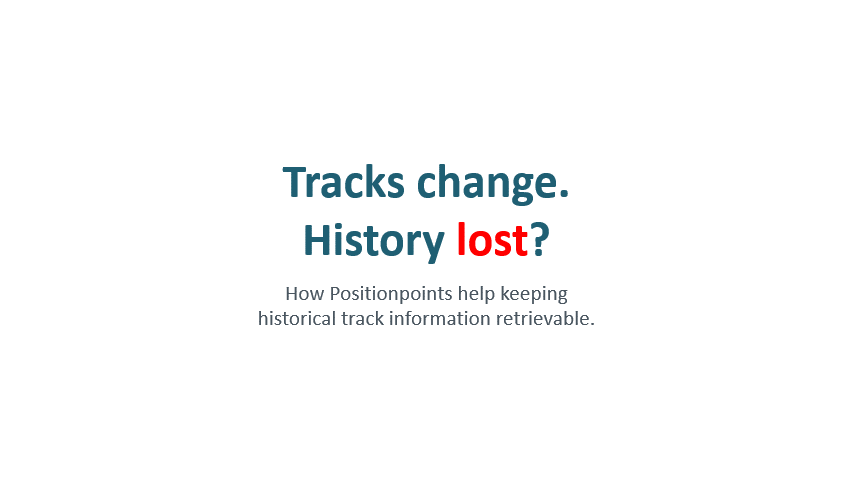

# MARS-Base: Positionpoints

**Positionpoints (PPs)** are stable, georeferenced, uniquely identified points at a fixed spacing (25cm by default) along railway tracks.
They give every small piece of track a permanent, georeferenced address that survives renamed tracks, new switches and changed topology systems.
They are a **base technology** for future maintenance application and international exchange of data for asset management and research.

This repository contains and open reference implementation: geospatial data pipelines that generate and maintain Positionpoints from public railway network data.
See the demo at https://explorer.mars-open.net/

## Why Positionpoints?

Railway infrastructure data is usually referenced to a **track topology**: track ID and position, or line and kilometer, switch numbers.
That topology changes quite often. Tracks are renamed, split by new switches, realigned or partially replaced.
Changes break the link between historical data (measurements, defects, maintenance work) and the track it belongs to, as new IDs are created.
Existing solutions try to maintain a mapping between historical and current topology using linear referencing.
This is hard to maintain and normally breaks after some years, but railway assets (should) have an average lifetime of 30-50 years.
The result is that historical data becomes hard to retrieve and compare, and the track loses its history.

Positionpoints decouple **where** something is from **which track object** it currently belongs to:

- **Stable identity**: a PP keeps its ID as long as the track stays at that location, whatever the topology calls it.
- **History stays retrievable**: measurements, defects and maintenance records attached to PPs can be compared over years, across topology versions.
- **A common language**: anyone working with tracks (inspection, track construction, maintenance, planning, research) can reference the same points, without converting topology reference systems.
- **Fine resolution, efficient processing**: numerical IDs derived from a spatial index makes processing millions of points practical.

Read more in [Business Motivation](docs/motivation.md).

## What it does

The open reference implementation

- Generates PPs along railway tracks at a configurable spacing, including switches and turnouts
- Snaps new topology versions to existing PPs, so IDs stay stable over time
- Provides a short Base32 token as human-readable PP identifier
- Outputs Delta tables, GeoParquet, FlatGeobuf and PMTiles for direct use in web applications

Currently implemented data sources:
- **Switzerland**: swissTopo TLM3D
- **OpenStreetMap / OpenRailwayMap**: global coverage with promising results in Germany. Elevation is mostly missing, but is compensated with bridge/tunnel information.

## Links

- Pipeline documentation and weekly test runs (SDLB Visualizer): https://base-pipelines.mars-open.net/
- Browse the created Positionpoints: [mars-explorer](https://github.com/mars-open/mars-explorer), live demo at https://explorer.mars-open.net/

## Documentation

- [Business Motivation](docs/motivation.md): the problem, the Positionpoint concept and its use cases
- [Architecture Decisions](docs/architecture-decisions.md): Spatial indexing, PP ID and token, creation rules, file formats, known limitations
- [Build & Run](docs/build.md): building, testing, preparing input data and running pipelines

## License

MARS Base is distributed under the GNU General Public License version 3 or later.
The full terms of the license can be found at https://www.gnu.org/licenses/gpl-3.0.en.html.

For this repository the GPLv3 is explicitly applied also to AI translations of the code to other programming languages, overruling any potentially different interpretation.

## Contributors

## Contributing

Contributions are welcome! Please fork the repository and submit a pull request with your changes.
