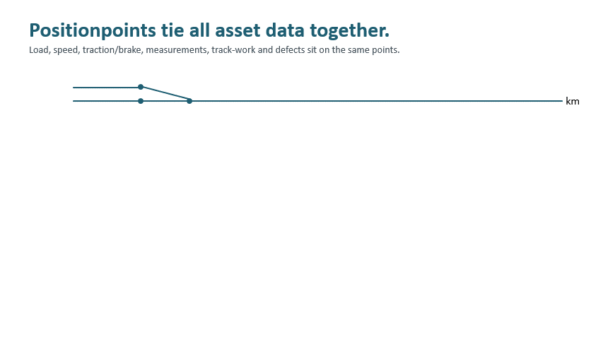

# Business Motivation

## The problem: tracks change, history gets lost

Asset data about railway tracks (inspection measurements, defects, maintenance and construction work) is typically referenced to the **track topology**:
a track ID and position, line and kilometer or a switch number.
The topology is a model, and it changes for reasons that have nothing to do with the physical rail:

- a new switch splits an existing track into two track objects
- tracks are renamed or renumbered
- a track is realigned, and its kilometer positions shift
- a part of a track is replaced and gets new IDs assigned
- different systems use different topology model resolutions for the same network, e.g. a node-edge model where a switch is a single node, and a model where switches are resolved into their individual branches
- the topology system is renewed

Each change breaks the reference between historical records and the infrastructure they describe.
Questions like *"how did this defect develop over the last ten years?"* then require manual, error-prone re-referencing, or cannot be answered at all.

## The idea: Positionpoints

A **Positionpoint (PP)** is a fixed, georeferenced point on the track, created at a regular spacing (25cm by default).
Each PP represents a small section of track (±12.5cm) and gets a permanent, unique ID.

The following animation shows the principle:

1. **2008**: Track 701 is described by Positionpoints, fixed georeferenced locations along the line.
2. **2015**: A new track and switch S7 are built. Track 701 is renamed to Track 1: the name changes, its points do not. Only the new track gets new points.
3. **2025**: A track is reconfigured. The old track object is gone, but all its points stay. Points no longer covered by a track are kept as *points without track*, and a current mapping from PPs to track and kilometer position is provided.

Every topology version is mapped to the same Positionpoints, so historical track information can always be retrieved:
**Positionpoints stay. Tracks change.**

## What defines a Positionpoint

A PP is defined by:
- X, Y, Z coordinates in a metric coordinate system (e.g. LV95 / EPSG:2056 in Switzerland, EPSG:25832 in Germany, ...)
- the azimuth (direction) of the underlying track

Additional attributes:
- `id`: 64-bit number, efficient for joins and aggregations
- `lat`, `lon`: GPS coordinates
- `zoom`: level for efficiently selecting coarser resolutions (0 = edge endpoints, 1 = every 10m, 2 = every 1m, 3 = base spacing)
- `token`: short, human-readable Base32 representation of the ID
- `cell id`: H3 cell of the spatial grid, used internally for efficient neighbor searches

X/Y, Z and azimuth must be available. Missing values are interpolated from neighboring track points or derived from the surroundings where possible, e.g. from bridge/tunnel information when OpenStreetMap lacks elevation.

See [Architecture Decisions](architecture-decisions.md) for how IDs, tokens and zoom levels are built.

## Lifecycle: keeping PPs and topology in sync

Whenever track objects in the source topology change, the affected objects are recalculated:
new track geometry is **snapped to existing PPs**, so that IDs are reused where the track did not move,
and new PPs are only created where none exist yet.
The mapping from PPs to the current track objects and kilometer positions is then updated.

Which tracks are covered (only the operational network, or also planned tracks) is controlled by the choice of the input topology.

## Use cases

Because all asset data is attached to the same Positionpoints, it can be combined and stacked over the years:
operational load (load/weight, speed, traction and braking), recurring inspection runs, track work such as a rail exchange or treatments, and detected defects.
Laid on top of each other, they make it possible to analyze complicated defects, e.g. why a squat was initiated at a specific location and how it developed after treatment.

Use cases include:

- **Long-term archiving** of track condition data as a basis for all kinds of forecasting, e.g. tamping demand or rolling contact fatigue (RCF)
- **Defect evolution**: following a single defect (e.g. a squat) across many years of inspection runs, even when the track was renamed or reconfigured in between
- **Technical and strategic asset management**: aggregations and evaluations across the whole network on a common spatial key
- **Operational communication**: inspection, measurement and track construction teams referencing the same points on the track. Track construction data is in turn particularly relevant for forecasting.

## Measurements and Positionpoints

Measurement train runs record samples at equidistant traveled distance. Mapping them onto PPs needs care:

**Dont discard the original equidistant recording.** Frequency filters can only be applied to equidistant data; once it is gone, it cannot be recovered from PP-mapped values. 

The link between a measurement train run and the PPs is a **route** from a train location system:
  - every measurement sample is assigned to one PP (measurement view), and
  - every PP can have one or more samples assigned (infrastructure view).

Keep this route together with the measurement data, so asset data can also be transferred back to the view of the train run.

## Scale and visualisation

A national network quickly reaches millions of PPs.
Showing all of them at once is neither possible nor useful:
at small map scales only the line is shown for orientation, at medium scales coarser resolutions are selected via the `zoom` attribute,
and the full 25cm resolution is loaded only when zoomed in.
Current web map technology (PMTiles, MapLibre) handles these point counts well, see the [demo](https://explorer.mars-open.net/?cfg=ch#7.91667/47.36036/14.62).

## Open reference implementation

This repository is a free and open reference implementation of the concept.
It can be used to create an initial PP dataset for a network from public data (swissTopo TLM3D, OpenStreetMap),
and as a blueprint for implementations on internal topology sources.
